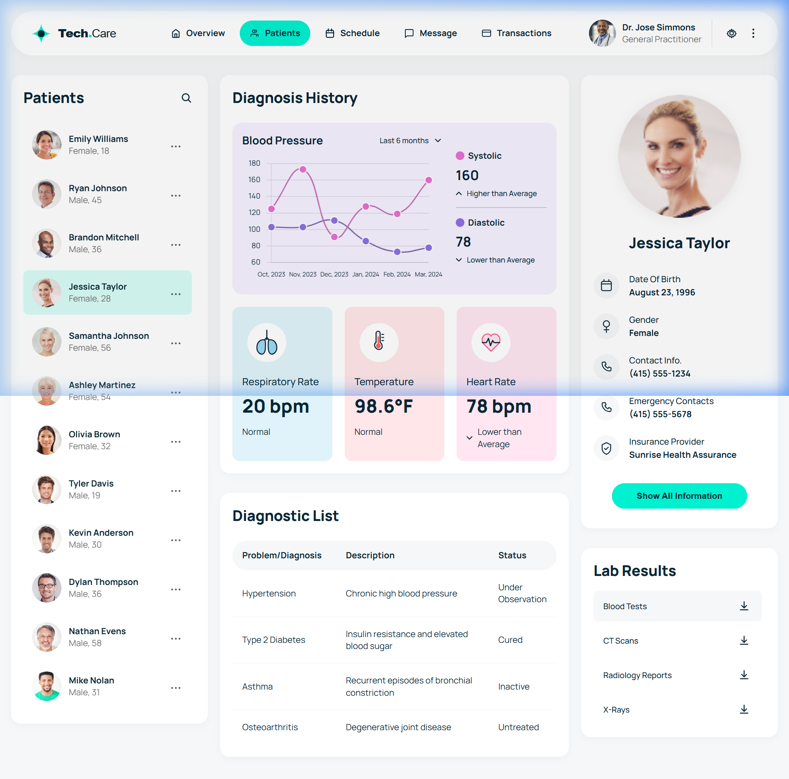

# Tech.Care - HealthCare Dashboard

> Front-End Developer Skills Assessment for **Coalition Technologies**  
> Conversion of Adobe XD Prototype into a responsive, single-page web application integrated with the Coalition Technologies Patient Data API and dynamic Chart.js blood pressure visualization.



---

## 🎯 Key Features & Requirements Achieved

1. **Pixel-Perfect Adobe XD Conversion**:
   - Accurately replicates typography, colors, layout dimensions, border radii, and visual hierarchy from the Adobe XD specifications.
   - Built with the exact Google Font: **Manrope** (weights 400, 500, 600, 700, 800).
   - Clean, semantic HTML5 structure (`<header>`, `<nav>`, `<aside>`, `<main>`, `<section>`, `<table>`, `<article>`).

2. **Coalition Technologies Patient Data API Integration**:
   - Endpoint: `https://fedskillstest.coalitiontechnologies.workers.dev`
   - **Dynamic Basic Auth Encryption**: Conforms strictly to security instructions by generating the HTTP Basic Auth header dynamically at runtime using `btoa('coalition:skills-test')` rather than hardcoding any pre-encrypted authorization keys.
   - Graceful offline fallback to local JSON dataset to ensure smooth evaluation in any environment (including local `file://` and offline testing).

3. **Target Patient: Jessica Taylor**:
   - Specifically displays and populates data for **Jessica Taylor**:
     - 6-month Blood Pressure statistics and trends.
     - Vitals: Respiratory Rate (`20 bpm`, Normal), Temperature (`98.6°F`, Normal), and Heart Rate (`78 bpm`, Lower than Average).
     - Diagnostic List table (`Hypertension`, `Type 2 Diabetes`, `Asthma`, `Osteoarthritis`).
     - Patient Profile sidebar (Photo, formatted Date of Birth, Gender, Contact, Emergency Contact, Insurance Provider).
     - Lab Results with download actions.
   - Patient directory on the left highlights Jessica Taylor as the active patient.

4. **Dynamic Blood Pressure Line Chart (Chart.js)**:
   - Uses [Chart.js](https://www.chartjs.org/) to visualize 6 months of historical blood pressure data chronologically (October 2023 to March 2024).
   - Dual smooth bezier cubic spline datasets matching the design mockups:
     - **Systolic**: Pink curve (`#C26EB4` / `#E66FD2`) with white-bordered circular point markers.
     - **Diastolic**: Purple curve (`#7E6CAB` / `#8C6FE6`) with white-bordered circular point markers.
   - All 6 month tick labels are clearly displayed horizontally without auto-skip.
   - Custom tooltips and subtle gridlines styled according to design tokens.

5. **Fully Responsive Layout**:
   - Desktop view (1600px grid) with 3-column layout (Left: Patients Sidebar, Center: Diagnosis & Diagnostic List, Right: Patient Profile & Lab Results).
   - Fluid media queries for 1400px, 1200px, 992px, 768px, and mobile viewports.

---

## 📁 File Structure

```
├── index.html              # Main semantic HTML5 template
├── styles.css              # Custom styling, CSS design tokens, responsive queries
├── app.js                  # API fetch, dynamic Basic Auth, Chart.js, DOM updates
├── patients.json           # Cached patient data for offline evaluation resilience
├── README.md               # Technical documentation and evaluation guide
└── assets/
    ├── icons/              # Vector SVGs (TechCare logo, vitals, profile icons, nav)
    │   ├── logo.svg
    │   ├── home.svg
    │   ├── patients.svg
    │   ├── calendar.svg
    │   ├── chat.svg
    │   ├── credit-card.svg
    │   ├── settings.svg
    │   ├── search.svg
    │   ├── respiratory.svg
    │   ├── temperature.svg
    │   ├── heart.svg
    │   ├── dob.svg
    │   ├── gender.svg
    │   ├── female.svg
    │   ├── phone.svg
    │   ├── insurance.svg
    │   ├── download.svg
    │   └── ...
    └── images/             # High-resolution avatars (Doctor & Patients)
        ├── doctor.png
        ├── 1.png - 12.png
        └── preview.png
```

---

## 🚀 How to Run Locally

You can run this project using any local web server or directly by opening `index.html`.

### Option 1: Using Python built-in HTTP server
```bash
# In the project directory:
python -m http.server 8080
```
Open your browser at [http://localhost:8080](http://localhost:8080).

### Option 2: Using Node.js `npx serve`
```bash
npx serve .
```

### Option 3: Direct Browser File Opening
Double-click `index.html` to open it in Chrome, Firefox, Safari, or Edge.

---

## 🔐 Authentication Details

In compliance with the skills test requirements:
> *"Hard coding the encrypted Basic Auth will be counted against you, we expect that you encrypt the key yourself using the proper methods."*

`app.js` encodes the credentials dynamically at runtime using browser-native `btoa`:
```javascript
function getBasicAuthHeader(username, password) {
  const credentials = `${username}:${password}`;
  return 'Basic ' + btoa(credentials);
}
```

---

## 🛠️ Technologies Used
- **HTML5**: Semantic tags, accessibility attributes, meta tags.
- **CSS3**: Custom properties (CSS variables), CSS Grid, Flexbox, responsive design.
- **JavaScript (ES6+)**: Fetch API, async/await, DOM manipulation, dynamic auth encryption.
- **Chart.js v4**: Smooth spline interpolation, custom canvas rendering.
- **Google Fonts**: `Manrope` typeface.
